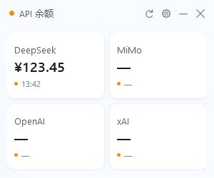
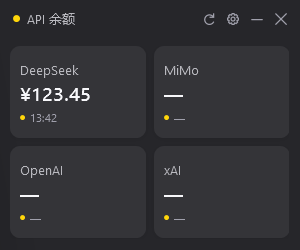
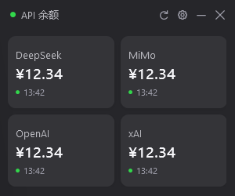
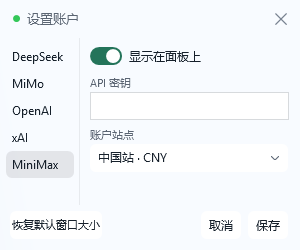

# 余额面板 · API Balance Panel

[English](README.en.md) | 简体中文

一个 300×250 的 Windows 桌面小面板，一屏看完 DeepSeek、OpenAI、Gemini、xAI、MiMo、Qwen、GLM、Kimi、MiniMax 九家的账户余额。

| 浅色 | 深色 |
|---|---|
|  |  |

## 它解决什么问题

每天挨个打开各家后台看余额，很烦。
这个面板把它们塞进一张 300×250 的卡片墙：双击就开，每分钟自动刷新，余额见底了一瞄就知道。



## 功能

- **九家服务商同屏**：DeepSeek、OpenAI、Gemini、xAI、MiMo、Qwen、GLM、Kimi、MiniMax
  其中 6 家填 API 密钥，3 家（OpenAI / Gemini / MiMo）走网页登录；xAI 要 Team ID，Qwen 要阿里云 AccessKey 对，Kimi 和 MiniMax 要选国内 / 国际区
- **卡片拖动排序**：长按约 0.3 秒后拖动，其它卡实时让位；松手保存，Esc 取消
- **跟随系统深浅色**，默认 300×250、系统圆角
- **F5 手动刷新**，或每分钟自动刷新
- **密钥只存本机**：Windows DPAPI 加密，不联网上传，不写日志、不导出
- **网页登录交给 WebView2**：不导出 cookie、不自动填密码、不开 DevTools

## 快速开始

1. 到 [Releases](https://github.com/Song-812/api-balance-panel/releases/latest) 下载 `api-balance-panel-v1.0.0.zip`
2. 解压到任意文件夹 —— **别只把 exe 拖出来**，它要和同目录的 dll、js 待在一起
3. 双击 `API余额面板.exe`
4. 点右上角齿轮 → 填各家的密钥或点「打开登录窗口」→ 保存



### 环境要求

| 需要 | 说明 |
|---|---|
| Windows x64 | 目前只在 Win11 26200 上测过 |
| .NET Framework 4.8 | Win10 1903+ 与 Win11 自带 |
| WebView2 Runtime | Win11 自带；缺失时到[微软官网](https://developer.microsoft.com/microsoft-edge/webview2/)装 Evergreen Runtime |

## 第一次使用要注意

- 密钥用当前 Windows 用户身份加密，**换电脑或换用户就解不开**，需要重填
- 默认显示 4 张卡，其余往下滚才出现；卡片顺序可拖动调整并保存
- 关掉某家的「显示在面板上」开关，会同时停止查询并释放网页会话，但本机配置保留
- 程序默认跟随 Windows 系统代理；**系统没设代理就直连**

## 从源码构建

需要 .NET Framework 4.8（Windows 自带）和 PowerShell，不需要 Visual Studio：

```powershell
cd src
.\Build.ps1
```

脚本会先跑完全部自动测试再编译，产物在仓库根的 `build\API余额面板\`。
可用 `-OutputRoot`、`-TestRoot` 指定输出与临时目录。

## 项目结构

    src/        源码（C# / WPF + 少量 JS）
    src/lib/    WebView2 运行时 DLL 及其许可证
    docs/       截图
    build/      构建产物（已 gitignore）

## 测试

328 项自动测试：Core 156、ViewState 10、SafeDiagnostics 3、UI 104、Browser DOM 55。
全部使用合成数据、内存 HTTP 与本机测试网页，不接触真实密钥，不读取用户配置。

## 已知限制

- 界面目前只有中文
- 只在 Win11 26200 / 100% 缩放测过；其它 Windows 版本、DPI、多显示器**未验证**
- 余额来自各家接口或网页，服务商改版就可能失效
- 个人自用工具，非官方，不对数据准确性作担保

## 许可证

MIT，见 [LICENSE](LICENSE)。
`src/lib/` 下的 WebView2 文件版权归 Microsoft，条款见 `WebView2-LICENSE.txt`。
